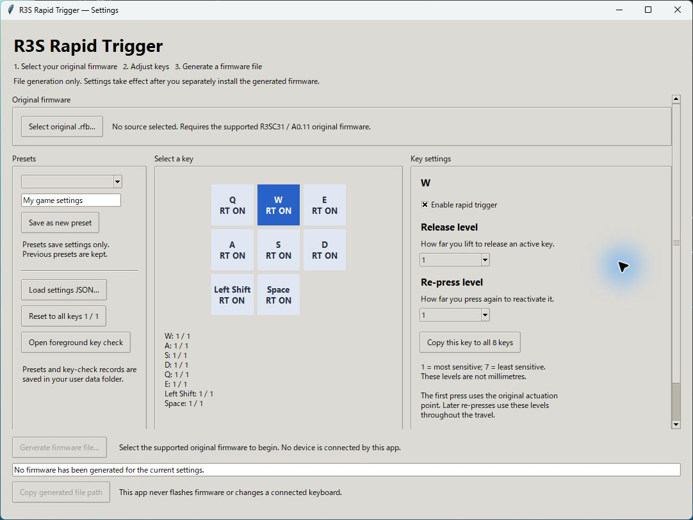

# R3S Rapid Trigger

An unofficial, experimental rapid trigger implementation for the REALFORCE R3S **R3SC31**, with an English settings app and a local firmware builder.

Eight physical keys are supported: **W, A, S, D, Q, E, Left Shift, and Space**. Release and re-press sensitivity can be set separately for each key. All other keys retain the stock input path.



This repository contains the project code and build tools. **It does not include an original or modified manufacturer firmware image, the manufacturer updater, or firmware backups.** You supply your own lawfully obtained, supported stock firmware file and generate a modified file on your computer. The app does not communicate with the keyboard or flash firmware.

## Compatibility

| Item | Supported / observed configuration |
| --- | --- |
| Keyboard | REALFORCE R3S R3SC31 |
| Stock firmware | A0.11, exact file identity below |
| RT keys | W / A / S / D / Q / E / Left Shift / Space |
| Stock APC | Four global APC selections, internal mode 1 / gain 0 |
| Individual APC modes | Unsupported |
| Hardware validation | One user's keyboard; good eight-key operation reported on October 9, 2026 |
| Host | Hardware workflow used on Windows; other operating systems are not hardware-validated |

The only accepted stock input is **65,568 bytes**, with SHA-256:

```text
c210e9b0447fa47047974a188f2b1e24b62b80dcc2443daa7d8f878823000da9
```

A similar model name or firmware version is not sufficient. The builder rejects other input files. Other R3/R3S models, layouts, hardware revisions, and firmware versions have not been validated. MCU identity, RAM capacity, and hardware recovery have not been confirmed by physical inspection. See [validation and limitations](docs/validation.md).

## Run locally

Use **Python 3.10 or newer** with Tk support. The normal Windows Python installer includes Tk. The application uses the Python standard library; there are no additional runtime packages.

Download and extract this repository, or clone it with Git. Open a terminal in the directory containing this README, then run:

```powershell
py -m r3s_rt gui
```

On systems without the Windows `py` launcher, use `python` in its place. No package installation or network connection is needed for that command. An editable installation with `python -m pip install -e .` is optional for development. Firmware inspection and generation may work on other systems, but that is not a claim of keyboard or updater compatibility.

## Generate a firmware file

1. Keep an unmodified copy of your supported stock `.rfb` file outside this repository.
2. Open the settings app and select the stock file.
3. Choose which of the eight keys use RT, then set their release and re-press levels. **Level 1 is most sensitive; level 7 is least sensitive. These are Raw sensor levels, not millimeters.**
4. Generate a firmware file at a new local `.rfb` path. Saving a preset only saves settings; it does not change the keyboard.
5. Review the output information, then use the manufacturer updater separately if you choose to install the generated file.

The default profile enables all eight keys at release level 1 / re-press level 1. The initial press still uses stock APC. After that, RT uses movement thresholds throughout the active travel range. The settings apply to the keyboard only after the generated file has been flashed.

For a first installation or a changed profile, follow the [setup and input-check guide](docs/getting-started.md). Keep access to a second keyboard and your original supported stock file. Restoring stock firmware requires a functioning update path; no recovery procedure for an unresponsive keyboard has been validated.

### Command line

Inspect a stock file without creating a modified file:

```powershell
python -m r3s_rt inspect "C:\path\to\stock.rfb"
```

Build with the default eight-key profile:

```powershell
python -m r3s_rt build "C:\path\to\stock.rfb" --output "C:\path\to\modified.rfb"
```

Build with a saved profile, or open the local input test:

```powershell
python -m r3s_rt build "C:\path\to\stock.rfb" --output "C:\path\to\modified.rfb" --profile "C:\path\to\profile.json"
python -m r3s_rt key-test
```

Keep all generated `.rfb` files and local backups private. Do not attach them to issues or commit them to a fork.

## How RT behaves

RT releases a held key after sufficient upward movement and presses it again after sufficient downward movement. It tracks the most recent peak and valley rather than requiring a return to one fixed activation point. Release and re-press levels are independent, and short re-presses are available above the bottom of the travel range.

Near the top, or after a rejected sample or configuration change, RT resets. Let the key return to rest and remain still for 32 valid quiet samples before trying again. Repeated tiny movements near the top can delay this rearming step. The sample count is an internal condition, **not a measured time in milliseconds**.

See [behavior and sensitivity](docs/behavior.md) for the exact thresholds, APC interaction, and reset conditions.

## Development and support

- [Architecture and local generation](docs/architecture.md)
- [Validation and known limitations](docs/validation.md)
- [Contributing and reporting an issue](CONTRIBUTING.md)
- [Third-party notices and research references](THIRD_PARTY_NOTICES.md)

The earlier local eight-key build was accepted by its user as a completed baseline. This public repository is still experimental: publication does not add hardware coverage, measured latency, millimeter calibration, or a verified recovery procedure.

Project-authored additions and tools use the MIT license in [LICENSE](LICENSE). Manufacturer material remains separate; that license does not cover a generated firmware image as a whole or grant rights to manufacturer firmware and trademarks. Local generation does not establish permission under the manufacturer's firmware terms. This project is not affiliated with or endorsed by Topre or REALFORCE. Product names are used only to identify the tested compatibility target.
